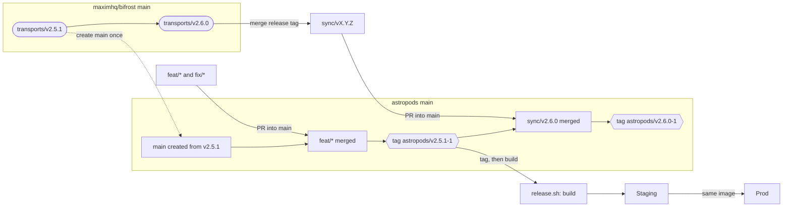

# Astropods Bifrost Fork Guide

> Copy of the team guide, exported 2026-11-13. The live, editable version is the [Astropods Bifrost Fork Guide](https://claude.ai/artifact/UJEPMz2XnMVb3qoWcj44Fo); update both when you change one.

We run Bifrost from our own fork, [astropods/bifrost](https://github.com/astropods/bifrost). `main` is our release branch: upstream Bifrost plus our commits, and we deploy only from tags on it.

## Why we fork

Bifrost OSS keeps virtual keys, budgets and rate limits in each node's memory and reads Postgres only at startup. With several replicas, a key created on one node is rejected by the others until they restart. Enterprise fixes this with gossip clustering; we fix it in our fork with Postgres `LISTEN/NOTIFY`.

What the fork adds, all behind flags so it behaves like upstream when they are off:

- **Virtual key sync** (`BIFROST_OSS_SYNC=1`): changes made on any node reach every node within milliseconds, with catch-up and reconcile loops for missed notifications.
- **Counter sync** (planned): budgets and rate limits shared across nodes instead of counted per node.
- **Our plugins** (planned): compiled into the gateway rather than loaded as `.so` files.

Background and design: the [architecture page](https://claude.ai/artifact/9RL3YSsRbLSPmeP9UF1c8A).

## Branches

`main` is the only long-lived branch we own. Everything else is short-lived and merges into it by PR.

| Branch | What it holds | Branches from | Merges into |
| --- | --- | --- | --- |
| `main` (default, protected) | Upstream `main` plus our commits. Always deployable. | — | — |
| `feat/*` | A change of ours, e.g. `feat/oss-vk-sync` | `main` | `main` by PR |
| `fix/*` | An urgent fix to what we run | `main` | `main` by PR, then a new tag |
| `sync/vX.Y.Z` | Bringing in an upstream release | `main` | `main` by PR |
| `release/X.Y` | Patching an older version after `main` moved on. Create only when needed. | the version's tag | nowhere; tag from it |

We do not use `dev`. Upstream works on `dev` and releases from `main`; `dev` is unreleased code that changes daily. Never commit to `dev` or build from it. If the fork has a `dev` branch, it only mirrors upstream.

## How changes flow



Upstream release tags are merged into our `main` through a `sync/*` PR; our own work comes in through `feat/*` and `fix/*` PRs. A tag on `main` is built by hand with `astropods/release.sh`, and that one image goes to staging, then prod.

## Making a change

1. Update `main` and branch from it: `git switch main && git pull` then `git switch -c feat/<name>`.
2. Put new files in `astropods/` (see Rules). Go code that has to sit in an upstream package goes in **new files** named after our feature (like `transports/bifrost-http/server/ossync.go`). Edit upstream files only for a few lines of wiring, and mark each edit with a comment naming our feature.
3. Put new behaviour behind an env flag that defaults to off, so the fork behaves like upstream when it is unset.
4. Build the way a release does, without the Go workspace: `cd transports && GOWORK=off go build ./bifrost-http`.
5. Run the upstream tests for any package you touched (`go test ./<package>/...`). Nothing runs them for you: there is no CI.
6. Open a PR into `main`: `gh pr create -R astropods/bifrost --base main`. Always pass `-R astropods/bifrost`; without it `gh` can target the upstream repo.
7. Squash-merge, so each feature stays one commit that is easy to find when we sync upstream.

## Releasing

We release by tagging `main` and building the image by hand with `astropods/release.sh`. There is no CI: GitHub Actions is disabled on the fork and stays off. One tag builds one image, and that same image moves from staging to prod.

- **Tag name:** `astropods/v<upstream version>-<our build>`, e.g. `astropods/v2.5.1-1`, then `astropods/v2.5.1-2` for our next release on the same upstream version. The prefix keeps our tags from clashing with upstream's `transports/v*` tags.
- **Tag:** `git switch main && git pull`, then `git tag astropods/v2.5.1-1` and `git push origin astropods/v2.5.1-1`.
- **Build:** `astropods/release.sh astropods/v2.5.1-1`. It checks out the tag in a clean tree, builds with `GOWORK=off`, checks that our code is in the binary, and pushes an image tagged with the same name. It stops at the first failure, so a failed build pushes nothing.
- **Promote, don't rebuild:** deploy the image to staging, let it run, then deploy the same image to prod.
- **Roll back:** redeploy the previous tag's image. Never move or delete a pushed tag.

## Taking an upstream release

Sync within a week or two of each upstream release (a new `transports/vX.Y.Z` tag on [maximhq/bifrost releases](https://github.com/maximhq/bifrost/releases)). Small, regular syncs keep conflicts small. Sync right after a release, not at random times: upstream sometimes merges hotfixes into `main` just before tagging.

1. Fetch upstream: `git fetch upstream --tags`.
2. Branch and merge the release tag: `git switch -c sync/v2.6.0 main` then `git merge transports/v2.6.0`. Merge, never rebase: `main` is shared, so history must not be rewritten.
3. Resolve conflicts in our patched files. Keep upstream's code and re-apply our wiring. Turn on `git config rerere.enabled true` so git remembers each resolution for next time.
4. Build with `GOWORK=off`, run the upstream tests.
5. Open a PR into `main`, merge it, then tag `astropods/v2.6.0-1`.

GitHub's "Sync fork" button merges upstream `main` (not a tag) into ours. It is fine right after a release, when the two match; prefer merging the tag.

## Rules

- **Our files live in `astropods/`.** Upstream never touches that folder, so nothing in it can conflict on a sync. It holds `README.md` (what the fork adds, linking this guide), `release.sh` (builds and pushes a release image) and `docs/` (design notes). The only exception is Go code that must sit inside an upstream package; it goes in new files named after our feature, like `server/ossync.go`.
- **Keep our footprint small.** Every line we change in an upstream file is a possible conflict on every sync, so keep those edits to a few lines of wiring.
- **Everything behind a flag, off by default.** With our flags unset the fork must behave exactly like upstream.
- **Keep GitHub Actions disabled.** The fork carries all of upstream's workflows, including ones that release and publish on every push to `main`. With Actions off none of them can run, so we leave the workflow files untouched and syncs stay conflict-free. Never re-enable Actions or click "enable workflows" on the Actions tab.
- **Watch the `GOWORK` gotcha.** Release builds use `GOWORK=off`, so `transports` pulls `core`, `framework` and the plugins from the Go module proxy at the versions in `transports/go.mod`, not from our folders. A change under `plugins/` or `framework/` is silently left out unless `transports/go.mod` has a `replace` line pointing at the local folder, e.g. `replace github.com/maximhq/bifrost/plugins/governance => ../plugins/governance`. `astropods/release.sh` checks our code is in the binary before it pushes an image.
- **The repo is public.** A fork of a public repo cannot be private. No secrets, customer names or internal hostnames in code, commits or PRs. If we need private code, it goes in a separate private repo.
- **Send wiring upstream when we can.** If maximhq accepts an extension point we need (for example, passing our own callbacks into `Bootstrap`), our patch shrinks and syncs get easier.

## Roadmap

The first release, `astropods/v2.5.1-1`, goes to staging once step 2 merges.

| Step | What | Done when | Status |
| --- | --- | --- | --- |
| 1. Set up the fork | `main` from upstream, default branch, branch protection, Actions disabled, release script | The release script turns a tag into a pushed image | Not started |
| 2. Virtual key sync | `feat/oss-vk-sync` PR; sync health exported as Prometheus metrics | A key made on one node works on all nodes within 1 s, no restarts | In progress |
| 3. Harden sync | Catch-up and reconcile for teams, customers, model configs; test behind PgBouncer and a Postgres failover | Checked by hand behind PgBouncer and through a Postgres failover | Not started |
| 4. Counter sync | Shared budgets and rate limits; `replace` lines in `transports/go.mod`; release-script check that our patch is in the binary | A $100 budget across 3 nodes stops at $100 plus at most 1 s of traffic | Not started |
| 5. Our plugins | Compiled into the fork | Plugins ship in the standard image | Not started |
| 6. First upstream sync | Merge the next `transports/v2.x` release | Tagged and running in staging | Not started |

Step 2 status: [astropods/bifrost#1](https://github.com/astropods/bifrost/pull/1) is open against `main`. It builds with `GOWORK=off` and passed 18/18 checks in a one-off local 3-node test.

## One-time setup

The fork was created with only `dev` and no tags, so `main` has to be created once. Whoever does it runs:

```bash
git clone https://github.com/astropods/bifrost.git
cd bifrost
git remote add upstream https://github.com/maximhq/bifrost.git
git fetch upstream main --tags
git switch -c main upstream/main
git push -u origin main
gh repo edit astropods/bifrost --default-branch main
```

Then protect `main` in the repo settings (PRs only, at least one approval). Everyone else just clones and adds the `upstream` remote:

```bash
git clone https://github.com/astropods/bifrost.git && cd bifrost && git remote add upstream https://github.com/maximhq/bifrost.git
```

To build locally with every module from your checkout, run `make setup-workspace` once (it creates a `go.work`, which is not committed). Release builds run without it.
